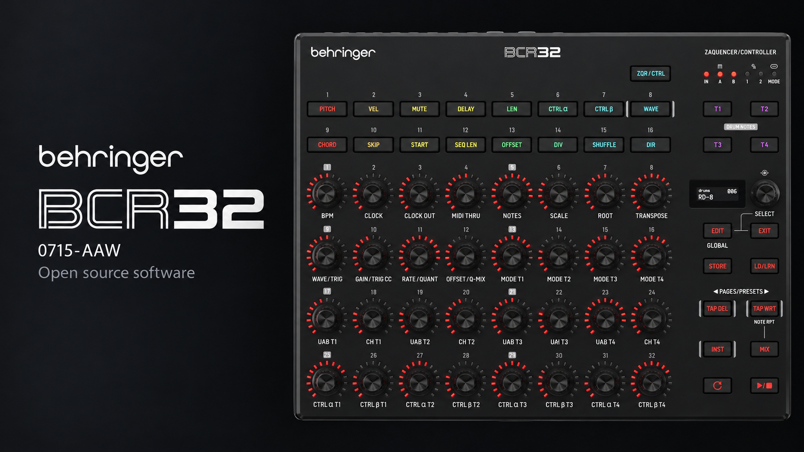
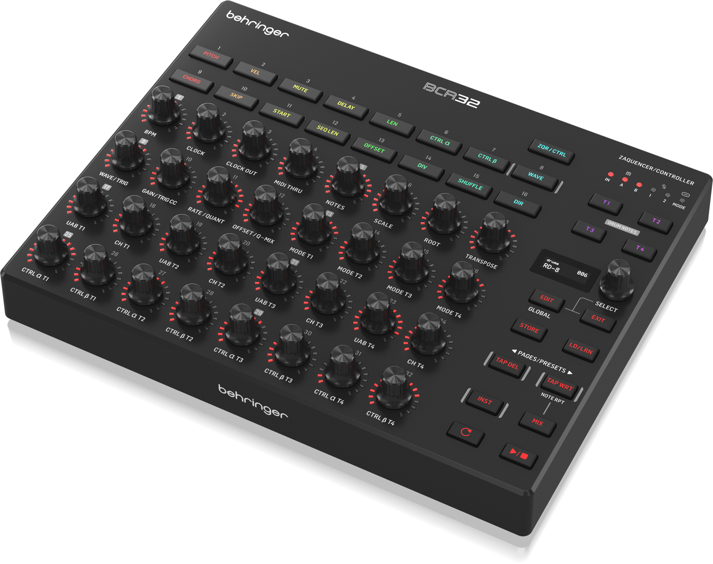
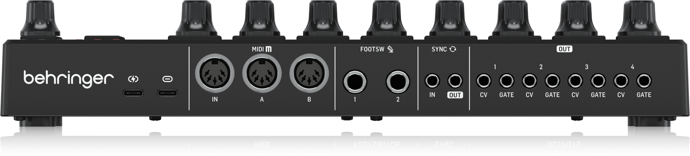

<p align="center">
  
</p>

# Behringer BCR32 (BE 0715-AAW)

Bare-metal demo firmware and hardware documentation for the Behringer BCR32.

<p align="center">
  
</p>

## Hardware

- GigaDevice GD32F405RE (Cortex-M4F, 120 MHz), 512 KB internal flash, 512 KB external SPI flash
- 32 push encoders with 15-LED rings, 16 RGB keys, 128 × 32 OLED
- 4 CV and 4 Gate outputs, SYNC in / out, two footswitch inputs
- USB-C with two virtual MIDI ports, MIDI IN and two MIDI OUTs
- Pin assignment and on-board devices: [MCU interface](docs/BCR32_MCU_Interface.md),
  schematic: [docs/BE_0715-AAW_01-Top_Rev03.pdf](docs/BE_0715-AAW_01-Top_Rev03.pdf)

## Demo firmware

The [`demo/`](demo) project is a bare-metal firmware that exercises every on-board
peripheral with a small example: buttons and encoders on the OLED, CV and Gate outputs, a SYNC
OUT → SYNC IN loopback test, DIN MIDI thru, USB MIDI echo, MIDI activity LEDs, external and
internal flash access by DMA, and entry into the bootloader for a firmware update over USB.
See [demo/README.md](demo/README.md) for the details.

## Connections

<p align="center">
  
</p>


| Rear                                               |
| -------------------------------------------------- |
| USB-C power input                                  |
| USB-C (USB MIDI: ports BCR-32 CTRL and BCR-32 ZAQ) |
| MIDI IN, MIDI OUT A, MIDI OUT B (5-pin DIN)        |
| FOOTSW 1, FOOTSW 2 (6.3 mm)                        |
| SYNC IN, SYNC OUT (3.5 mm)                         |
| CV / GATE OUT 1–4 (3.5 mm)                        |

## Repository


| Folder          | Contents                                            | License           |
| --------------- | --------------------------------------------------- | ----------------- |
| [`demo/`](demo) | Demo firmware, Keil MDK project, update image tools | AGPL-3.0-or-later |
| [`docs/`](docs) | MCU interface, schematic, images, [entering the bootloader](docs/BCR32_Firmware_Update_Protocol.md) | AGPL-3.0-or-later |

The root [`LICENSE`](LICENSE) is the AGPL-3.0 text that covers the Music Tribe code.
Third-party components (GigaDevice GD32F4xx peripheral and USB libraries, CMSIS, the SSD1306 OLED
driver) keep their original licenses.

## Building

### Tools


| Tool                                             | Version                          | Notes                                                                                                                                         |
| ------------------------------------------------ | -------------------------------- | --------------------------------------------------------------------------------------------------------------------------------------------- |
| Windows                                          | 10 or 11                         | The project, its build steps and the update tool run on Windows only                                                                          |
| [Keil MDK](https://www.keil.arm.com/) (µVision) | 5.x                              |                                                                                                                                               |
| Arm Compiler 5 (ARMCC)                           | 5.06 update 7                    | Included in MDK up to 5.36. With a newer MDK, install it separately and add it in**Project → Manage → Project Items → Folders/Extensions** |
| Device pack                                      | `GigaDevice::GD32F4xx_DFP` 3.0.3 | Install with the µVision**Pack Installer**                                                                                                   |

### Build in µVision

1. Open `demo/Project/keil/bcr32_demo.uvprojx`.
2. The project has one target, `BCR32_Demo`.
3. **Project → Build Target** (F7), or **Rebuild all target files** for a clean build.

After each build `fromelf` writes the firmware as a binary and
`demo/tools/update/generate_BCR.bat` copies it to `demo/tools/update/`. The version in the file
name comes from `demo/App/version.h`.

### Build from the command line

From the top folder of the repository:

```
C:\Keil_v5\UV4\UV4.exe -r demo/Project/keil/bcr32_demo.uvprojx -t BCR32_Demo -j0 -o build.log
```

`-r` rebuilds all files (`-b` builds the changed ones), `-t` selects the target, `-j0` hides the µVision window and
`-o` writes the build output to `build.log` next to the project. The exit code is 0 without errors or warnings, 1
with warnings only, 2 or more with errors.

### Build with GCC (CMake)

Alternatively, with CMake 3.20+, Ninja and the GNU Arm Embedded toolchain on the `PATH`:

```
cmake -S demo/Project/gcc -B build -G Ninja
cmake --build build
```

On Windows this build also writes the update file described below.

### Output and installation

The build writes the firmware update file
`demo/tools/update/BCR32_FW_V<version>_<date>_<time>.bin`. Files of earlier builds are kept
(each has its own date and time); delete them by hand when no longer needed. Install it on the
BCR32 over USB:

```
demo\tools\update\windows\update.exe demo\tools\update\BCR32_FW_V<version>_<date>_<time>.bin
```

The tool makes the running demo start the bootloader over USB, transfers the image and restarts
the device; no key needs to be pressed.

### Troubleshooting


| Message                                         | Cause                                                                                            |
| ----------------------------------------------- | ------------------------------------------------------------------------------------------------ |
| `... not found` after the build                 | The after-build step did not run: Keil `fromelf` (check that Arm Compiler 5 is installed under the MDK folder) or GCC `objcopy` |
| `Version ... or date not found` after the build | `demo/App/version.h` is missing or its `SOFTWARE_VERSION_*` values are not plain decimal numbers |
| `No BCR32 found yet` from `update.exe`          | The BCR32 is not connected over USB, or another program (DAW, MIDI monitor) holds its MIDI ports |

## Community

- **Chat with us:** [Discord](https://discord.gg/gS6qtuShvw)
- **Contribute:** fork the repository and open a pull request. No membership needed. See the
  [contributing guide](https://github.com/MusicTribeOpenSource/.github/blob/main/CONTRIBUTING.md).
- **Report a security problem** privately: [Report a vulnerability](https://github.com/MusicTribeOpenSource/0715-AAW/security/advisories/new).

---

Behringer is a brand of MUSIC Tribe. The Behringer name and logo, and the BCR32 name and logo, are
trademarks and are not covered by the software licenses in this repository.

Copyright (c) MUSIC Tribe.
